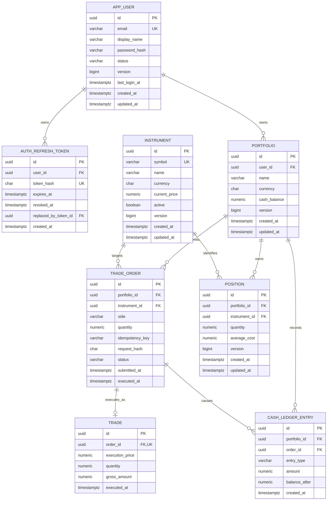

# TradeFlow Database Schema

## 1. Purpose

This document defines the initial PostgreSQL data model for the TradeFlow backend. It supports:

- UC-001: Register User
- UC-002: Log In
- UC-003: Refresh Access Token
- UC-004: Log Out
- UC-005: Create Portfolio
- UC-006: View Instruments
- UC-007: Submit Buy Order
- UC-008: Submit Sell Order

The design follows the decisions in `architecture.md`: a modular monolith, synchronous order execution, Flyway-owned schema changes, explicit database constraints, optimistic versioning, UTC timestamps, and `NUMERIC` values for money.

## 2. Scope and Assumptions

The first release uses the following simplified trading model:

- Users authenticate with a normalized email address and password.
- Passwords are stored only as adaptive password hashes, never as plaintext or reversible encryption.
- A short-lived JWT access token is used for API authorization.
- An opaque, rotatable refresh token is stored client-side; only its SHA-256 hash is stored in PostgreSQL.
- Each portfolio belongs to exactly one user. A user can own multiple portfolios.
- All orders are market orders executed synchronously and in full.
- Each order produces at most one trade.
- Fractional quantities are supported to eight decimal places.
- A portfolio has one base currency.
- An instrument can be traded only when it is active and its currency matches the portfolio currency.
- Fees, taxes, reservations, partial fills, limit orders, and multiple currencies are deferred.
- A position row is retained when its quantity reaches zero, preserving its identity and version history.
- An idempotency key is unique per portfolio, allowing different portfolios to generate the same client-side key safely.

## 3. Entity Relationship Diagram



## 4. Table Definitions

### 4.1 `app_user`

Stores credentials and lifecycle state for a TradeFlow user. The name avoids the reserved/general SQL term `user`.

| Column | PostgreSQL type | Null | Rules / meaning |
| --- | --- | ---: | --- |
| `id` | `UUID` | No | Primary key; generated by the application |
| `email` | `VARCHAR(320)` | No | Normalized lowercase login identifier; unique |
| `display_name` | `VARCHAR(120)` | No | Trimmed, non-blank name shown in the UI |
| `password_hash` | `VARCHAR(255)` | No | Encoded adaptive hash produced by Spring Security |
| `status` | `VARCHAR(20)` | No | `ACTIVE`, `LOCKED`, or `DISABLED` |
| `version` | `BIGINT` | No | JPA optimistic-lock version |
| `last_login_at` | `TIMESTAMPTZ` | Yes | Most recent successful login instant |
| `created_at` | `TIMESTAMPTZ` | No | Registration instant in UTC |
| `updated_at` | `TIMESTAMPTZ` | No | Last modification instant in UTC |

Normalize email in the application before insertion and lookup. The unique constraint is the concurrency-safe final guard against duplicate registration. Return a generic login error rather than revealing whether an email exists.

### 4.2 `auth_refresh_token`

Stores refresh-token sessions so they can be rotated and revoked. JWT access tokens are not stored because they are short-lived and verified cryptographically.

| Column | PostgreSQL type | Null | Rules / meaning |
| --- | --- | ---: | --- |
| `id` | `UUID` | No | Primary key |
| `user_id` | `UUID` | No | Foreign key to `app_user` |
| `token_hash` | `CHAR(64)` | No | Unique SHA-256 hash of the opaque token |
| `expires_at` | `TIMESTAMPTZ` | No | Time after which refresh is rejected |
| `revoked_at` | `TIMESTAMPTZ` | Yes | Set when logged out, rotated, or administratively revoked |
| `replaced_by_token_id` | `UUID` | Yes | Self-reference to the next token after rotation |
| `created_at` | `TIMESTAMPTZ` | No | Session creation instant |

The raw refresh token must never be logged or stored. A refresh succeeds only when the hash exists, belongs to an active user, has not expired, and has not been revoked. Rotation revokes the presented token and creates a replacement in one transaction.

### 4.3 `portfolio`

Stores the portfolio identity and its current simulated cash balance.

| Column | PostgreSQL type | Null | Rules / meaning |
| --- | --- | ---: | --- |
| `id` | `UUID` | No | Primary key; generated by the application |
| `user_id` | `UUID` | No | Owning user; foreign key to `app_user` |
| `name` | `VARCHAR(120)` | No | Trimmed, non-blank portfolio name |
| `currency` | `CHAR(3)` | No | ISO-style uppercase code; `USD` by default |
| `cash_balance` | `NUMERIC(19,4)` | No | Must be greater than or equal to zero |
| `version` | `BIGINT` | No | JPA optimistic-lock version |
| `created_at` | `TIMESTAMPTZ` | No | Creation instant in UTC |
| `updated_at` | `TIMESTAMPTZ` | No | Last modification instant in UTC |

Portfolio names are unique per user, not globally. The database constraint on `cash_balance` is the final guard against overspending. The application must still perform ownership and business validation and return a meaningful error.

### 4.4 `instrument`

Stores the seeded instruments available for simulated trading and their current prices.

| Column | PostgreSQL type | Null | Rules / meaning |
| --- | --- | ---: | --- |
| `id` | `UUID` | No | Primary key |
| `symbol` | `VARCHAR(20)` | No | Unique, uppercase trading symbol |
| `name` | `VARCHAR(200)` | No | Non-blank display name |
| `currency` | `CHAR(3)` | No | Currency of the quoted price |
| `current_price` | `NUMERIC(19,4)` | No | Must be greater than zero |
| `active` | `BOOLEAN` | No | Only active instruments are returned/tradable |
| `version` | `BIGINT` | No | Optimistic version for price updates |
| `created_at` | `TIMESTAMPTZ` | No | Creation instant |
| `updated_at` | `TIMESTAMPTZ` | No | Last update instant |

`current_price` is sufficient for the MVP. A later market-data module should store price history separately instead of overwriting the only historical price. Executed prices are always copied into `trade`, so past executions do not change when the current price changes.

### 4.5 `trade_order`

Stores a submitted order, including the original request identity and lifecycle status.

| Column | PostgreSQL type | Null | Rules / meaning |
| --- | --- | ---: | --- |
| `id` | `UUID` | No | Primary key |
| `portfolio_id` | `UUID` | No | Foreign key to `portfolio` |
| `instrument_id` | `UUID` | No | Foreign key to `instrument` |
| `side` | `VARCHAR(4)` | No | `BUY` or `SELL` |
| `quantity` | `NUMERIC(19,8)` | No | Must be greater than zero |
| `idempotency_key` | `VARCHAR(100)` | No | Client-supplied key; unique within a portfolio |
| `request_hash` | `CHAR(64)` | No | SHA-256 of the canonical order payload |
| `status` | `VARCHAR(12)` | No | `PENDING`, `EXECUTED`, or `REJECTED` |
| `rejection_code` | `VARCHAR(50)` | Yes | Stable machine-readable reason for rejection |
| `submitted_at` | `TIMESTAMPTZ` | No | Time accepted for processing |
| `executed_at` | `TIMESTAMPTZ` | Yes | Set only for an executed order |

The `request_hash` prevents a client from accidentally reusing an idempotency key for a different request:

- Same key and same hash: return the existing order/result.
- Same key and different hash: return an idempotency conflict.
- New key: create and process a new order.

### 4.6 `position`

Stores the current quantity held for one portfolio/instrument pair.

| Column | PostgreSQL type | Null | Rules / meaning |
| --- | --- | ---: | --- |
| `id` | `UUID` | No | Primary key |
| `portfolio_id` | `UUID` | No | Foreign key to `portfolio` |
| `instrument_id` | `UUID` | No | Foreign key to `instrument` |
| `quantity` | `NUMERIC(19,8)` | No | Must be greater than or equal to zero |
| `average_cost` | `NUMERIC(19,4)` | No | Weighted average purchase cost; zero for an empty position |
| `version` | `BIGINT` | No | JPA optimistic-lock version |
| `created_at` | `TIMESTAMPTZ` | No | Creation instant |
| `updated_at` | `TIMESTAMPTZ` | No | Last modification instant |

The unique key `(portfolio_id, instrument_id)` ensures that concurrent requests cannot create two positions for the same holding.

Average cost rules for the MVP:

- Buy: `newAverageCost = ((oldQuantity × oldAverageCost) + grossAmount) / newQuantity`.
- Sell: average cost remains unchanged while quantity remains positive.
- Sell to zero: set both quantity and average cost to zero.

Apply an explicit rounding policy in Java when calculating `average_cost`.

### 4.7 `trade`

Stores the immutable execution generated by an order.

| Column | PostgreSQL type | Null | Rules / meaning |
| --- | --- | ---: | --- |
| `id` | `UUID` | No | Primary key |
| `order_id` | `UUID` | No | Unique foreign key to `trade_order` |
| `execution_price` | `NUMERIC(19,4)` | No | Instrument price captured at execution |
| `quantity` | `NUMERIC(19,8)` | No | Executed quantity |
| `gross_amount` | `NUMERIC(19,4)` | No | Rounded `execution_price × quantity` |
| `executed_at` | `TIMESTAMPTZ` | No | Execution instant |

The unique constraint on `order_id` enforces the MVP rule of at most one execution per order.

### 4.8 `cash_ledger_entry`

Provides an immutable audit trail for every cash balance change.

| Column | PostgreSQL type | Null | Rules / meaning |
| --- | --- | ---: | --- |
| `id` | `UUID` | No | Primary key |
| `portfolio_id` | `UUID` | No | Foreign key to `portfolio` |
| `order_id` | `UUID` | Yes | Causing order; null for the initial deposit |
| `entry_type` | `VARCHAR(20)` | No | `INITIAL_DEPOSIT`, `BUY_DEBIT`, or `SELL_CREDIT` |
| `amount` | `NUMERIC(19,4)` | No | Signed amount: debit negative, credit positive |
| `balance_after` | `NUMERIC(19,4)` | No | Portfolio balance after this entry |
| `created_at` | `TIMESTAMPTZ` | No | Entry creation instant |

For an executed order, `(order_id, entry_type)` is unique. This provides another database-level barrier against applying the same order's cash movement twice.

## 5. PostgreSQL DDL

This DDL is the recommended starting point for Flyway migrations.

```sql
CREATE TABLE app_user (
    id              UUID PRIMARY KEY,
    email           VARCHAR(320) NOT NULL,
    display_name    VARCHAR(120) NOT NULL,
    password_hash   VARCHAR(255) NOT NULL,
    status          VARCHAR(20) NOT NULL DEFAULT 'ACTIVE',
    version         BIGINT NOT NULL DEFAULT 0,
    last_login_at   TIMESTAMPTZ,
    created_at      TIMESTAMPTZ NOT NULL DEFAULT CURRENT_TIMESTAMP,
    updated_at      TIMESTAMPTZ NOT NULL DEFAULT CURRENT_TIMESTAMP,

    CONSTRAINT uk_app_user_email UNIQUE (email),
    CONSTRAINT ck_app_user_email_normalized
        CHECK (email = lower(btrim(email)) AND btrim(email) <> ''),
    CONSTRAINT ck_app_user_display_name_non_blank
        CHECK (btrim(display_name) <> ''),
    CONSTRAINT ck_app_user_password_hash_non_blank
        CHECK (btrim(password_hash) <> ''),
    CONSTRAINT ck_app_user_status
        CHECK (status IN ('ACTIVE', 'LOCKED', 'DISABLED'))
);

CREATE TABLE auth_refresh_token (
    id                      UUID PRIMARY KEY,
    user_id                 UUID NOT NULL,
    token_hash              CHAR(64) NOT NULL,
    expires_at              TIMESTAMPTZ NOT NULL,
    revoked_at              TIMESTAMPTZ,
    replaced_by_token_id    UUID,
    created_at              TIMESTAMPTZ NOT NULL DEFAULT CURRENT_TIMESTAMP,

    CONSTRAINT fk_refresh_token_user
        FOREIGN KEY (user_id) REFERENCES app_user (id),
    CONSTRAINT fk_refresh_token_replacement
        FOREIGN KEY (replaced_by_token_id) REFERENCES auth_refresh_token (id),
    CONSTRAINT uk_refresh_token_hash UNIQUE (token_hash),
    CONSTRAINT uk_refresh_token_replacement UNIQUE (replaced_by_token_id),
    CONSTRAINT ck_refresh_token_hash_format
        CHECK (token_hash ~ '^[0-9a-f]{64}$'),
    CONSTRAINT ck_refresh_token_revocation_time
        CHECK (revoked_at IS NULL OR revoked_at >= created_at)
);

CREATE TABLE portfolio (
    id              UUID PRIMARY KEY,
    user_id         UUID NOT NULL,
    name            VARCHAR(120) NOT NULL,
    currency        CHAR(3) NOT NULL DEFAULT 'USD',
    cash_balance    NUMERIC(19,4) NOT NULL,
    version         BIGINT NOT NULL DEFAULT 0,
    created_at      TIMESTAMPTZ NOT NULL DEFAULT CURRENT_TIMESTAMP,
    updated_at      TIMESTAMPTZ NOT NULL DEFAULT CURRENT_TIMESTAMP,

    CONSTRAINT fk_portfolio_user
        FOREIGN KEY (user_id) REFERENCES app_user (id),
    CONSTRAINT uk_portfolio_user_name UNIQUE (user_id, name),
    CONSTRAINT ck_portfolio_name_non_blank
        CHECK (btrim(name) <> ''),
    CONSTRAINT ck_portfolio_currency_uppercase
        CHECK (currency ~ '^[A-Z]{3}$'),
    CONSTRAINT ck_portfolio_cash_non_negative
        CHECK (cash_balance >= 0)
);

CREATE TABLE instrument (
    id              UUID PRIMARY KEY,
    symbol          VARCHAR(20) NOT NULL,
    name            VARCHAR(200) NOT NULL,
    currency        CHAR(3) NOT NULL DEFAULT 'USD',
    current_price   NUMERIC(19,4) NOT NULL,
    active          BOOLEAN NOT NULL DEFAULT TRUE,
    version         BIGINT NOT NULL DEFAULT 0,
    created_at      TIMESTAMPTZ NOT NULL DEFAULT CURRENT_TIMESTAMP,
    updated_at      TIMESTAMPTZ NOT NULL DEFAULT CURRENT_TIMESTAMP,

    CONSTRAINT uk_instrument_symbol UNIQUE (symbol),
    CONSTRAINT ck_instrument_symbol_format
        CHECK (symbol ~ '^[A-Z0-9][A-Z0-9.-]{0,19}$'),
    CONSTRAINT ck_instrument_name_non_blank
        CHECK (btrim(name) <> ''),
    CONSTRAINT ck_instrument_currency_uppercase
        CHECK (currency ~ '^[A-Z]{3}$'),
    CONSTRAINT ck_instrument_price_positive
        CHECK (current_price > 0)
);

CREATE TABLE trade_order (
    id                UUID PRIMARY KEY,
    portfolio_id      UUID NOT NULL,
    instrument_id     UUID NOT NULL,
    side              VARCHAR(4) NOT NULL,
    quantity          NUMERIC(19,8) NOT NULL,
    idempotency_key   VARCHAR(100) NOT NULL,
    request_hash      CHAR(64) NOT NULL,
    status            VARCHAR(12) NOT NULL,
    rejection_code    VARCHAR(50),
    submitted_at      TIMESTAMPTZ NOT NULL DEFAULT CURRENT_TIMESTAMP,
    executed_at       TIMESTAMPTZ,

    CONSTRAINT fk_order_portfolio
        FOREIGN KEY (portfolio_id) REFERENCES portfolio (id),
    CONSTRAINT fk_order_instrument
        FOREIGN KEY (instrument_id) REFERENCES instrument (id),
    CONSTRAINT uk_order_portfolio_idempotency UNIQUE (portfolio_id, idempotency_key),
    CONSTRAINT ck_order_side
        CHECK (side IN ('BUY', 'SELL')),
    CONSTRAINT ck_order_quantity_positive
        CHECK (quantity > 0),
    CONSTRAINT ck_order_idempotency_key_non_blank
        CHECK (btrim(idempotency_key) <> ''),
    CONSTRAINT ck_order_request_hash_format
        CHECK (request_hash ~ '^[0-9a-f]{64}$'),
    CONSTRAINT ck_order_status
        CHECK (status IN ('PENDING', 'EXECUTED', 'REJECTED')),
    CONSTRAINT ck_order_lifecycle
        CHECK (
            (status = 'PENDING'  AND executed_at IS NULL AND rejection_code IS NULL)
         OR (status = 'EXECUTED' AND executed_at IS NOT NULL AND rejection_code IS NULL)
         OR (status = 'REJECTED' AND executed_at IS NULL AND rejection_code IS NOT NULL)
        )
);

CREATE TABLE position (
    id                UUID PRIMARY KEY,
    portfolio_id      UUID NOT NULL,
    instrument_id     UUID NOT NULL,
    quantity          NUMERIC(19,8) NOT NULL DEFAULT 0,
    average_cost      NUMERIC(19,4) NOT NULL DEFAULT 0,
    version           BIGINT NOT NULL DEFAULT 0,
    created_at        TIMESTAMPTZ NOT NULL DEFAULT CURRENT_TIMESTAMP,
    updated_at        TIMESTAMPTZ NOT NULL DEFAULT CURRENT_TIMESTAMP,

    CONSTRAINT fk_position_portfolio
        FOREIGN KEY (portfolio_id) REFERENCES portfolio (id),
    CONSTRAINT fk_position_instrument
        FOREIGN KEY (instrument_id) REFERENCES instrument (id),
    CONSTRAINT uk_position_portfolio_instrument
        UNIQUE (portfolio_id, instrument_id),
    CONSTRAINT ck_position_quantity_non_negative
        CHECK (quantity >= 0),
    CONSTRAINT ck_position_average_cost_non_negative
        CHECK (average_cost >= 0),
    CONSTRAINT ck_position_empty_average_cost
        CHECK (quantity > 0 OR average_cost = 0)
);

CREATE TABLE trade (
    id                UUID PRIMARY KEY,
    order_id          UUID NOT NULL,
    execution_price   NUMERIC(19,4) NOT NULL,
    quantity          NUMERIC(19,8) NOT NULL,
    gross_amount      NUMERIC(19,4) NOT NULL,
    executed_at       TIMESTAMPTZ NOT NULL,

    CONSTRAINT fk_trade_order
        FOREIGN KEY (order_id) REFERENCES trade_order (id),
    CONSTRAINT uk_trade_order UNIQUE (order_id),
    CONSTRAINT ck_trade_price_positive
        CHECK (execution_price > 0),
    CONSTRAINT ck_trade_quantity_positive
        CHECK (quantity > 0),
    CONSTRAINT ck_trade_gross_amount_positive
        CHECK (gross_amount > 0)
);

CREATE TABLE cash_ledger_entry (
    id                UUID PRIMARY KEY,
    portfolio_id      UUID NOT NULL,
    order_id          UUID,
    entry_type        VARCHAR(20) NOT NULL,
    amount            NUMERIC(19,4) NOT NULL,
    balance_after     NUMERIC(19,4) NOT NULL,
    created_at        TIMESTAMPTZ NOT NULL DEFAULT CURRENT_TIMESTAMP,

    CONSTRAINT fk_cash_ledger_portfolio
        FOREIGN KEY (portfolio_id) REFERENCES portfolio (id),
    CONSTRAINT fk_cash_ledger_order
        FOREIGN KEY (order_id) REFERENCES trade_order (id),
    CONSTRAINT uk_cash_ledger_order_type UNIQUE (order_id, entry_type),
    CONSTRAINT ck_cash_ledger_entry_type
        CHECK (entry_type IN ('INITIAL_DEPOSIT', 'BUY_DEBIT', 'SELL_CREDIT')),
    CONSTRAINT ck_cash_ledger_balance_non_negative
        CHECK (balance_after >= 0),
    CONSTRAINT ck_cash_ledger_amount_direction
        CHECK (
            (entry_type = 'INITIAL_DEPOSIT' AND order_id IS NULL AND amount >= 0)
         OR (entry_type = 'BUY_DEBIT'       AND order_id IS NOT NULL AND amount < 0)
         OR (entry_type = 'SELL_CREDIT'     AND order_id IS NOT NULL AND amount > 0)
        )
);
```

## 6. Indexes

Primary keys and unique constraints already create indexes. Add only the indexes needed by known access paths:

```sql
-- Revoke or list a user's active refresh-token sessions.
CREATE INDEX ix_refresh_token_user_active
    ON auth_refresh_token (user_id, expires_at)
    WHERE revoked_at IS NULL;

-- List a user's portfolios, newest first.
CREATE INDEX ix_portfolio_user_created
    ON portfolio (user_id, created_at DESC);

-- UC-006: list active instruments ordered by symbol.
CREATE INDEX ix_instrument_active_symbol
    ON instrument (symbol)
    WHERE active = TRUE;

-- Portfolio order history, newest first.
CREATE INDEX ix_order_portfolio_submitted
    ON trade_order (portfolio_id, submitted_at DESC);

-- Instrument order history and operational analysis.
CREATE INDEX ix_order_instrument_submitted
    ON trade_order (instrument_id, submitted_at DESC);

-- Portfolio positions; the unique constraint starts with portfolio_id,
-- so it already supports this lookup.

-- Portfolio cash history, newest first.
CREATE INDEX ix_cash_ledger_portfolio_created
    ON cash_ledger_entry (portfolio_id, created_at DESC);
```

Do not add a separate index for `trade.order_id`, `auth_refresh_token.token_hash`, `(trade_order.portfolio_id, trade_order.idempotency_key)`, or `(position.portfolio_id, position.instrument_id)`; their unique constraints already provide suitable indexes.

## 7. Transaction and Concurrency Design

### 7.1 Register User

One transaction should:

1. Normalize the email address.
2. Validate the display name and password policy.
3. Hash the password with Spring Security's configured `PasswordEncoder`.
4. Insert `app_user` and rely on the email unique constraint for concurrent duplicate registration.
5. Commit without issuing long-lived credentials automatically unless the API contract explicitly defines registration as login.

### 7.2 Log In

1. Load the user by normalized email.
2. Verify that the account is active and compare the submitted password with `password_hash`.
3. Generate a short-lived signed JWT access token.
4. Generate a cryptographically random opaque refresh token.
5. Store only the refresh token's SHA-256 hash in `auth_refresh_token`.
6. Update `last_login_at`, commit, and return the raw tokens over TLS.

Password verification should use the same generic failure response for an unknown email, incorrect password, or unavailable account. Rate limiting belongs at the API/security boundary.

### 7.3 Refresh and Log Out

Refresh-token rotation is one transaction: lock or atomically update the presented token row, verify it is usable, revoke it, insert its replacement, and connect `replaced_by_token_id`. Concurrent reuse must allow only one rotation to succeed. Logout sets `revoked_at` for the presented refresh token; the access token remains valid only until its short expiry.

### 7.4 Create Portfolio

One transaction should:

1. Resolve the authenticated user from the validated access token.
2. Validate the name and initial cash.
3. Insert `portfolio` with the authenticated user's ID.
4. Insert one `INITIAL_DEPOSIT` ledger entry, including when the initial amount is zero.
5. Commit and return the portfolio.

### 7.5 Submit Buy Order

One database transaction should:

1. Insert a `PENDING` order with the idempotency key using an atomic conflict-safe operation such as `INSERT ... ON CONFLICT DO NOTHING`.
2. If no row was inserted because `(portfolio_id, idempotency_key)` already exists, load the existing order and compare `request_hash`. Do not catch a PostgreSQL unique-violation and continue in the same transaction without a savepoint, because the transaction will already be marked failed.
3. Load the active instrument and capture `current_price`.
4. Calculate and round `grossAmount = price × quantity`.
5. Load the portfolio and its position.
6. Verify matching currencies and sufficient cash.
7. Subtract cash and update the position quantity/average cost.
8. Insert the immutable `trade`.
9. Insert a negative `BUY_DEBIT` cash ledger entry.
10. Mark the order `EXECUTED` and commit.

The portfolio and position `version` columns detect conflicting concurrent updates. A bounded retry may re-run a safe operation, but it must reuse the same idempotency key and re-evaluate price/balance rules.

Before processing, verify that the selected portfolio belongs to the authenticated user. Prefer an ownership-scoped repository query such as `findByIdAndUserId` so another user's portfolio is indistinguishable from a missing portfolio.

### 7.6 Submit Sell Order

One database transaction should:

1. Perform the same idempotency handling as a buy.
2. Load the active instrument, portfolio, and position.
3. Verify the position quantity is sufficient.
4. Reduce the position without allowing it to become negative.
5. Add the rounded gross amount to cash.
6. Insert the immutable `trade`.
7. Insert a positive `SELL_CREDIT` cash ledger entry.
8. Mark the order `EXECUTED` and commit.

The same ownership rule applies to sell orders.

### 7.7 Locking Choice

The architecture currently chooses optimistic locking. This is reasonable for an MVP with low contention, but it has an important implementation detail: creating the first position concurrently can produce a unique-key conflict before optimistic locking applies. Handle this by either:

- retrying the transaction after the `(portfolio_id, instrument_id)` unique conflict; or
- creating a zero-quantity position with a safe insert-if-absent operation before updating it.

If measurements later show frequent conflicts on a heavily traded portfolio, use a deliberate pessimistic write lock for that portfolio and its position. Do not combine several locking approaches without documenting the order in which rows are acquired.

## 8. Idempotency Contract

The API should require an `Idempotency-Key` header for order submission.

Canonical hash input should include at least:

```text
portfolioId | instrumentId | side | normalizedQuantity
```

Normalization is important: numerically equal values such as `1`, `1.0`, and `1.00000000` should produce the same canonical quantity and hash.

Recommended responses:

- First successful submission: return the created/executed order.
- Replay with identical key and payload: return the existing result without executing again.
- Replay with identical key but different payload: return HTTP `409 Conflict`.

Never implement idempotency as a check-then-insert sequence without relying on the unique constraint. Two requests can both pass the check under concurrency.

## 9. Use-Case Traceability

| Acceptance criterion | Schema enforcement / application responsibility |
| --- | --- |
| Email required and unique | `NOT NULL`, normalization check, and `uk_app_user_email` |
| Password is never stored directly | Application hashes it; only `password_hash` is persisted |
| Only active users can log in | Application checks `app_user.status` |
| Refresh token can be revoked/expired | `auth_refresh_token.revoked_at` and `expires_at` |
| Refresh token cannot be reused after rotation | Transactional rotation and unique token hash |
| Portfolio belongs to authenticated user | `portfolio.user_id` foreign key and ownership-scoped queries |
| Portfolio name required | `NOT NULL` and `ck_portfolio_name_non_blank`; API validation |
| Portfolio name unique for its owner | `uk_portfolio_user_name` |
| Initial cash cannot be negative | `ck_portfolio_cash_non_negative`; API validation |
| Unique portfolio ID | `portfolio.id` primary key |
| Seeded instruments | Flyway reference-data migration |
| Symbol, name, and price required | `NOT NULL` constraints and value checks |
| Only active instruments returned | Repository query uses `WHERE active = TRUE` |
| Portfolio and instrument must exist | Foreign keys plus application-level not-found errors |
| Quantity must be positive | Order and trade quantity check constraints |
| Sufficient cash | Application rule plus non-negative portfolio balance constraint |
| Sufficient units | Application rule plus non-negative position quantity constraint |
| Duplicate key creates no new order | Unique `(portfolio_id, idempotency_key)` |
| Buy reduces cash/increases position | Single transaction; ledger debit; versioned aggregates |
| Sell increases cash/reduces position | Single transaction; ledger credit; versioned aggregates |
| Cash never becomes negative | `ck_portfolio_cash_non_negative` |
| Position never becomes negative | `ck_position_quantity_non_negative` |

## 10. JPA Mapping Notes

- Map UUID identifiers with `@Id`; generate UUIDs in the application before persistence.
- Map `app_user.version`, `portfolio.version`, `position.version`, and `instrument.version` with `@Version`.
- Use `BigDecimal` for every `NUMERIC` column.
- Map user status, order side/status, and ledger entry type with `@Enumerated(EnumType.STRING)` and keep the database check constraints synchronized with Java values.
- Map timestamps as `Instant`.
- Keep associations lazy where practical and load explicit projections for API responses.
- Do not cascade deletes from users, portfolios, or instruments into orders, trades, or ledger history.
- Never expose `password_hash` or `token_hash` through entity serialization, logs, API DTOs, or `toString`.
- Load portfolios and orders using authenticated-user ownership in the query, not by loading an unrestricted entity and checking it only in the controller.
- Set `updated_at` explicitly in application/entity lifecycle logic; the database default covers inserts only.
- Use `BigDecimal.compareTo`, not `equals`, for numeric business comparisons.

## 11. Flyway Migration Plan

Suggested initial files:

```text
backend/src/main/resources/db/migration/
├── V1__create_user_and_auth_tables.sql
├── V2__create_portfolio_and_instrument.sql
├── V3__create_order_position_trade_and_cash_ledger.sql
├── V4__create_tradeflow_indexes.sql
└── V5__seed_initial_instruments.sql
```

For a simple seed set that should never be retroactively changed, use the versioned seed migration above. Use a repeatable migration only when its SQL safely upserts the complete reference set and rerunning it is intentional.

## 12. Deferred Schema Extensions

Add these only when the corresponding business behavior is introduced:

- roles and administrative authorization beyond normal portfolio ownership
- email verification, password reset, multi-factor authentication, and social login
- device/session metadata and “log out all devices” controls
- order types, limit price, expiry, cancellation, and time-in-force
- partial fills (remove the unique constraint on `trade.order_id`)
- fee, tax, net amount, and realized profit/loss
- cash reservations and position reservations for asynchronous processing
- instrument price history and external market-data source metadata
- multi-currency cash balances and foreign-exchange rates
- outbox/inbox tables for reliable messaging
- order/event history for a complete lifecycle audit trail

## 13. Important Design Boundary

The database can guarantee structural invariants such as unique normalized emails, token uniqueness, ownership references, non-negative balances, and referential integrity. It cannot enforce every authentication rule or express the complete cross-table rule that a cash or position update exactly matches a trade. Authentication checks belong in Spring Security and the application layer; trading consistency comes from updating the order, portfolio, position, trade, and cash ledger in one short application-service transaction, backed by concurrency tests against PostgreSQL.
